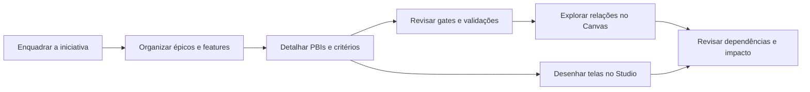

# NEXO

**Da intenção de negócio à entrega de software, com contexto, decisões e impacto rastreáveis.**

NEXO é um protótipo de plataforma para estruturar o trabalho de produto e engenharia em torno de um modelo compartilhado. Ele conecta projetos, épicos, features e PBIs em um grafo navegável, organiza a evolução por gates e reúne backlog, validações, decisões e protótipos de interface no mesmo fluxo.

O princípio central é manter a intenção e suas evidências ligadas ao que será construído. A IA pode ajudar a fazer perguntas, organizar informações e propor conteúdo; decisões de negócio, aprovações de gates e mudanças em itens aprovados continuam sob responsabilidade humana.

> **Estado do projeto:** protótipo funcional de interface, com dados de demonstração e persistência local no navegador. Os recursos descritos neste README refletem o código deste repositório; serviços de backend, colaboração remota e provedores externos de IA não são pressupostos.

## O que você pode explorar

- **Projetos e enquadramento:** crie um projeto por um wizard guiado que coleta problema, objetivo, público, escopo e métrica; ou inicie a ingestão de documentação de um projeto existente.
- **Backlog conectado:** trabalhe com épicos, features e PBIs e navegue entre os itens e seus vínculos.
- **Canvas de conhecimento:** visualize e explore o grafo do projeto, selecione objetos e examine suas relações e contexto.
- **Gates de descoberta e entrega:** acompanhe a progressão do trabalho, confira checklists e validações, e registre revisão, aprovação e exceções conforme as regras implementadas no protótipo.
- **Ingestão assistida:** forneça conteúdo ou documentação para estruturar informações e identificar o que ainda precisa ser esclarecido.
- **Studio de telas:** monte protótipos de interface com telas, componentes, camadas e propriedades; visualize o resultado e gere prompts de apoio ao design.
- **Rastreabilidade e impacto:** consulte vínculos entre os objetos e sinalizações de mudança para ajudar a revisar artefatos dependentes.
- **Usuários e papéis:** explore a experiência de usuários e permissões de demonstração.

O projeto também inclui uma biblioteca de microespecificações em [`nexo-especificacoes/`](nexo-especificacoes/), cobrindo visão, permissões, modelo de conhecimento, gates, agentes, fichas de trabalho, arquitetura, segurança e métricas.

## Fluxo de trabalho



O Canvas apresenta o grafo e o Studio permite prototipar telas relacionadas a features. O fluxo demonstra a abordagem pretendida e o estado atual da interface; não representa uma integração com pipeline de deploy ou execução de código de produção.

## Tecnologias

- [Vue 3](https://vuejs.org/) com Composition API
- [TypeScript](https://www.typescriptlang.org/)
- [Vite](https://vite.dev/) para desenvolvimento e build
- [Pinia](https://pinia.vuejs.org/) para estado da aplicação
- [Vue Router](https://router.vuejs.org/) para navegação
- [Tailwind CSS](https://tailwindcss.com/) e `vueui-nova-kit` para a interface
- `lucide-vue-next` para ícones

## Requisitos

- Node.js compatível com as ferramentas do projeto (recomenda-se uma versão LTS atual)
- npm

## Executar localmente

```bash
git clone https://github.com/walpinheiro/nexus.git
cd nexus
npm install
npm run dev
```

O Vite inicia o servidor de desenvolvimento em `http://127.0.0.1:5173`.

## Scripts disponíveis

| Comando | Descrição |
| --- | --- |
| `npm run dev` | Inicia o servidor de desenvolvimento Vite. |
| `npm run build` | Executa a verificação de tipos com `vue-tsc` e gera o build de produção em `dist/`. |
| `npm run preview` | Serve localmente o build existente para inspeção. |
| `npm run test:determinism` | Executa a verificação de determinismo disponível no projeto. |
| `npm run test:waivers` | Executa a verificação de exceções (waivers) disponível no projeto. |

Há outros scripts de validação em [`scripts/`](scripts/), incluindo verificações para Canvas, ingestão, wizard e edição de artefatos.

## Navegação da aplicação

| Rota | Área |
| --- | --- |
| `/` | Projetos e criação guiada |
| `/backlog` | Backlog e itens do projeto atual |
| `/canvas` | Contexto, grafo e relações do projeto |
| `/gates/:id` | Revisão de um gate |
| `/studio-full` | Studio de prototipação de telas |
| `/usuarios` | Usuários e papéis de demonstração |

## Dados e limites do protótipo

O projeto utiliza dados iniciais definidos no código e armazena estado de demonstração no `localStorage` do navegador. Isso torna simples experimentar os fluxos localmente, mas não oferece, por si só, sincronização entre dispositivos, autenticação, controle de acesso em servidor ou persistência compartilhada entre pessoas. Use dados fictícios ao explorar o protótipo.

As referências de produto e os contratos pretendidos estão documentados em `nexo-especificacoes/`. Consulte esses documentos para distinguir a visão de longo prazo das capacidades já implementadas na aplicação.

## Estrutura do repositório

```text
src/
├── ai/             # habilidades, ingestão e apoio aos fluxos por gate
├── components/     # componentes de UI, Canvas, backlog e Studio
├── data/           # dados de demonstração
├── router/         # rotas da aplicação
├── stores/         # estado e persistência local
├── utils/          # validação, gates, impacto, compartilhamento e exportação
└── views/          # páginas principais
scripts/            # verificações e scripts de validação
docs/               # notas de design e auditoria
nexo-especificacoes/ # microespecificações de produto
```

## Princípios de produto

- **Rastreabilidade:** mantenha objetivos, decisões, requisitos e artefatos relacionados.
- **Aprovação humana:** a IA auxilia o trabalho, sem decidir sozinha questões de negócio.
- **Mudança visível:** avalie dependências antes de atualizar conteúdo aprovado.
- **Fontes explícitas:** diferencie informação declarada, inferência e decisão pendente.
- **Evolução versionada:** preserve o histórico e evite sobrescrever baselines.

Esses princípios são desenvolvidos nas microespecificações, em especial [`01 — Visão e princípios`](nexo-especificacoes/01-visao-e-principios.md), [`04 — Modelo de conhecimento`](nexo-especificacoes/04-modelo-de-conhecimento.md) e [`19 — Segurança e IA responsável`](nexo-especificacoes/19-seguranca-e-ia-responsavel.md).

## Contribuindo

Mudanças são bem-vindas. Para alterações de produto, consulte as microespecificações relacionadas, preserve a rastreabilidade do modelo e descreva no pull request o comportamento alterado e as verificações executadas.

## Licença

Nenhum arquivo de licença foi identificado neste repositório. Até que uma licença seja adicionada, todos os direitos permanecem reservados e não há concessão explícita de permissão para reutilização ou redistribuição.
